<a href="https://taver-versch.github.io">
  <picture>
    <source media="(prefers-color-scheme: dark)" srcset="https://raw.githubusercontent.com/Taver-Versch/Taver-Versch/output/profile-dark.svg">
    
  </picture>
</a>

I'm a Software Engineering student at UNL with a networking focus, and I work with the UNL ITS network team. Most of what I build is for work, for my homelab, or for Break.In, the game I'm making with Amtav Games.

**[Portfolio](https://taver-versch.github.io)** · **[LinkedIn](https://www.linkedin.com/in/taverversch/)** · **[Amtav Games](https://amtavgames.com)**

### Right now
- Studying for the CCNA (January 2027), then Security+
- Product Manager on my senior design team, building a multi-user WebXR protein lab with a voice assistant
- Running a 2-node Proxmox homelab with my own DNS, VPN, and a Wazuh security lab
- Shipping Break.In with Amtav Games (December 2026)
- Looking for summer 2027 internships

### Projects
| | |
|---|---|
| **[AuditTool](https://github.com/Taver-Versch/AuditTool)** | Fills in network audit spreadsheets. My ITS team has used it on 60+ closets, and each one went from over an hour to under a minute. `Python` |
| **[VR Protein Analysis Lab](https://taver-versch.github.io/senior-design)** | Senior design. I integrated the "Hey Husker" voice assistant with our Django and LangChain backend. `WebXR` `Django` |
| **[Zulip Merge Channels](https://taver-versch.github.io/zulip-merge-channels)** | Merge Channels feature for the open-source Zulip chat app, issue #15634. PR open upstream. `Python` `Django` `TypeScript` |
| **[Homelab](https://taver-versch.github.io/homelab)** | Proxmox cluster with Pi-hole DNS and DHCP, WireGuard and Tailscale, and a Kali-to-Wazuh lab. `Proxmox` `Docker` |
| **[Voice Demo for WebXR](https://github.com/Taver-Versch/voice_demo)** | Compares wake word and speech-to-text engines in the browser on Vision Pro and Quest. `JavaScript` `Flask` |
| **[Portfolio Site](https://github.com/Taver-Versch/Taver-Versch.github.io)** | My own Python site generator, deployed with GitHub Actions. `Python` `CI/CD` |

More on [my site](https://taver-versch.github.io/projects).

### Tools
**Languages** Python · C# · Java · JavaScript · TypeScript · SQL 
**Infrastructure** Proxmox · Docker · Linux · Pi-hole · WireGuard · Tailscale · Wazuh · Wireshark 
**Development** Django · Flask · Unity · Git · GitHub Actions
